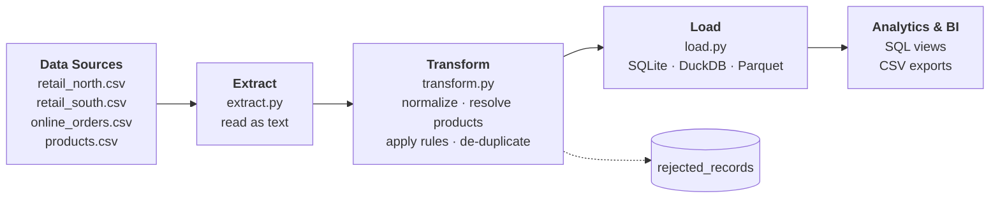

# 01 · Sales Data Integration

Integrate several CSV files with **different structures**, normalize their columns, resolve
inconsistencies, and load the result into **SQLite** (optionally DuckDB / Parquet).

**Demonstrates:** Python · Pandas · SQL · ETL · idempotent loads · regression testing.

---

## 1. Problem

A retailer sells through three channels. Each channel exports its own CSV and nobody agrees on
a format, so there is no single place to answer simple questions such as *"how much did we sell
in January?"*. Merging the files by hand is slow, error-prone, and impossible to repeat.

## 2. Analysis

| Source | File | Delimiter | Dates | Decimals | Product identified by | Price column |
|--------|------|-----------|-------|----------|-----------------------|--------------|
| North stores | `retail_north.csv` | `,` | `2024-01-05` (ISO) | `19.99` | name | unit price |
| South stores | `retail_south.csv` | `;` | `03/01/2024` (DD/MM/YYYY) | `19,99` | name | unit price |
| Online shop  | `online_orders.csv` | `,` | `2024-01-04T10:15:00Z` | `19.99` | **SKU** | **order total** + currency + status |

Difficulties found in the data (all present in the sample files):

- Different column names, delimiters, date formats and decimal separators.
- Customer names with inconsistent casing and spacing (`carol white`, `JACK TAYLOR`); online orders only have an e-mail.
- Product names written in several ways (`" wireless mouse "`, `USB-C hub`) and a product that does not exist.
- Exact duplicate orders with different order IDs, missing and negative quantities, an impossible date (`32/01/2024`).
- Cancelled orders and a non-USD order that must not be mixed with USD revenue.

## 3. Proposed Solution

A three-stage ETL pipeline:

1. **Extract** each file with its own reader, reading everything as *text* so nothing is silently converted.
2. **Transform** each source into one common schema, resolve products against a reference catalog,
   apply ordered business rules, and split the data into **clean** and **rejected** records (every rejection has a reason).
3. **Load** the clean data into a relational model with constraints, plus analytical views.

Design decisions:

- Rejected rows are **never dropped silently**: they are stored in `rejected_records` with a reason code.
- The load is **idempotent**: tables are recreated, so running the pipeline twice gives the same result.
- The product catalog is the single source of truth for product names and categories.

## 4. Architecture



## 5. Implementation

| File | Responsibility |
|------|----------------|
| `src/extract.py` | One reader per source (delimiter, encoding, trimming) + product catalog reader. |
| `src/transform.py` | `standardize_*` per source → common schema; `resolve_products`; ordered `RULES`; duplicate detection. |
| `src/load.py` | SQLite DDL (PK, FK, CHECK constraints), views, CSV export; optional DuckDB and Parquet. |
| `src/pipeline.py` | CLI entry point and run summary. |
| `tests/test_sales_pipeline.py` | Unit tests for each rule and standardizer + end-to-end comparison with `data/expected/`. |

**Stack:** Python 3.10+, pandas, SQLite (standard library). Optional: DuckDB, PyArrow.

Unified schema produced by the pipeline:

`order_id · order_date · customer · product_id · product_name · category · quantity · unit_price · total_amount · channel · source_file`

## 6. Data Quality

Rules are applied **in order**; the first failed rule becomes the reject reason.

| Order | Rule | Meaning |
|-------|------|---------|
| 1 | `CANCELLED_ORDER` | Order status is not `completed`. |
| 2 | `UNSUPPORTED_CURRENCY` | Only USD is supported in this version. |
| 3 | `INVALID_DATE` | Date cannot be parsed as a real calendar date. |
| 4 | `UNKNOWN_PRODUCT` | Name / SKU not found in the product catalog. |
| 5 | `MISSING_QUANTITY` | Quantity is empty or not a number. |
| 6 | `NON_POSITIVE_QUANTITY` | Quantity is zero or negative. |
| 7 | `INVALID_PRICE` | Price is missing or negative. |
| 8 | `DUPLICATE_RECORD` | Same date, customer, product, quantity, price and channel as an earlier row. |

Additional controls: primary key on `order_id`, `CHECK` constraints on quantity and price,
foreign key to `products`, and a test that proves `input rows = clean rows + rejected rows`
(no row is ever lost).

## 7. Results

Running the pipeline on the sample data:

| Metric | Value |
|--------|-------|
| Input rows (3 files) | 26 |
| Clean rows loaded | 18 |
| Rejected rows | 8 |
| Total revenue (USD) | 1,961.00 |

### Run metrics

| Metric | Value |
|--------|------:|
| Records received | 26 |
| Records valid | 18 |
| Records rejected | 8 |
| Duplicates detected | 1 (`DUPLICATE_RECORD`) |
| Validations passed | 6 / 6 |
| Execution time | ≈ 44 ms (median of 7 runs; machine-dependent) |

Validation checks run after the load: no record lost (26 = 18 + 8) · `order_id` unique · every rejected record has a reason ·
SQLite sales rows = clean rows · SQLite rejected rows = rejected rows · revenue in SQLite = revenue in the clean data.
Written to `data/output/metrics.json` on every run.

Rejected records by reason: `UNKNOWN_PRODUCT` 2 · `CANCELLED_ORDER` 1 · `DUPLICATE_RECORD` 1 ·
`INVALID_DATE` 1 · `MISSING_QUANTITY` 1 · `NON_POSITIVE_QUANTITY` 1 · `UNSUPPORTED_CURRENCY` 1.

Revenue by channel: `retail_south` 834.84 · `online` 604.79 · `retail_north` 521.37.

Output of the `v_monthly_revenue` view:

| month | orders | units | revenue |
|-------|-------:|------:|--------:|
| 2024-01 | 16 | 25 | 1,804.02 |
| 2024-02 | 2 | 5 | 156.98 |

The exact expected outputs are versioned in [`data/expected/`](data/expected/):
`sales_clean.csv`, `rejected_records.csv` and `run_summary.json`.

## 8. Reproducibility

```bash
# from the repository root
python -m venv .venv && source .venv/bin/activate      # Windows: .venv\Scripts\activate
pip install -r 01-sales-data-pipeline/requirements.txt

python 01-sales-data-pipeline/src/pipeline.py
```

Generated in `data/output/`: `sales.db`, `sales_clean.csv`, `rejected_records.csv`, `run_summary.json`, `metrics.json`.

Verify the result against the expected output:

```bash
diff 01-sales-data-pipeline/data/output/sales_clean.csv 01-sales-data-pipeline/data/expected/sales_clean.csv
pytest 01-sales-data-pipeline/tests -q
```

Query the database:

```bash
sqlite3 01-sales-data-pipeline/data/output/sales.db "SELECT * FROM v_monthly_revenue;"
```

Optional engines:

```bash
pip install duckdb pyarrow
python 01-sales-data-pipeline/src/pipeline.py --engine duckdb --parquet
```

> The DuckDB and Parquet exporters are optional and are not covered by the automated tests.
