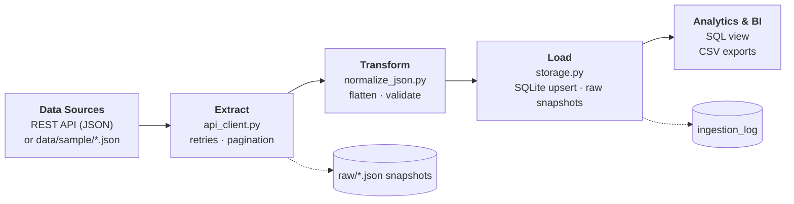

# 02 · API Data Extraction

Consume a public REST API, extract JSON, normalize nested structures, handle errors and
pagination, and store the results in SQLite with an ingestion audit log.

**Demonstrates:** REST APIs · `requests` · JSON · pagination · retries · automation-ready design.

---

## 1. Problem

Useful data often lives behind an API, not in files. An API call can fail, return data in pages,
contain nested objects, or return incomplete records. A one-off script that works today will
break silently tomorrow. We need an extraction process that is **reliable, repeatable and auditable**.

## 2. Analysis

The example uses the public [JSONPlaceholder](https://jsonplaceholder.typicode.com) API
(`/users` and `/posts`). Challenges the pipeline has to solve:

- **Pagination** — posts are returned page by page (`_page` / `_limit`). The pipeline must stop correctly on a short *or* an empty page.
- **Nested JSON** — each user contains `address`, `address.geo` and `company` objects that must be flattened.
- **Unreliable network** — timeouts, `429` and `5xx` responses are transient and should be retried; `4xx` errors are not.
- **Incomplete / invalid records** — a user without geolocation, an invalid e-mail, a post with a blank title, a post that points to a user that does not exist, and a duplicated post ID (typical when pagination pages overlap).
- **Auditability** — it must be possible to know when each run happened, from which source, and whether it succeeded.

## 3. Proposed Solution

1. A small `ApiClient` with timeouts, **exponential backoff** and clear error types.
2. A generic `fetch_paginated()` that walks the pages of any endpoint.
3. Normalizers that flatten JSON into tabular structures and validate them, returning clean *and* rejected records.
4. SQLite storage with **upserts** (re-running never duplicates data) and an `ingestion_log` table.
5. Raw JSON snapshots saved before any transformation, so a run can always be audited or re-processed.
6. An offline `FileClient` with the same interface as the live client, so the project is fully reproducible **without internet access**.

## 4. Architecture



## 5. Implementation

| File | Responsibility |
|------|----------------|
| `src/api_client.py` | `ApiClient` (retries, backoff, timeouts), `FileClient` (offline), `fetch_paginated`. |
| `src/normalize_json.py` | `normalize_users` (flatten nested JSON), `normalize_posts` (validate and reject with reasons). |
| `src/storage.py` | SQLite schema, upserts, raw snapshots, ingestion log, `v_posts_per_user` view. |
| `src/api_pipeline.py` | CLI: orchestrates extraction → normalization → storage. |
| `tests/test_api_pipeline.py` | Tests with a fake HTTP session (no network): retries, 4xx/5xx, pagination, normalization, end-to-end. |

**Stack:** Python 3.10+, `requests`, pandas, SQLite.

Retry policy: `429, 500, 502, 503, 504` and network errors → retried up to 3 times with exponentially growing delays (1s, 2s, …);
any other `4xx` → fails immediately.

## 6. Data Quality

| Check | Applies to | Action |
|-------|-----------|--------|
| Response is a JSON list / valid JSON | every call | `ApiError` |
| Duplicate `user_id` | users | keep first, log a warning |
| E-mail format | users | kept, flagged with `email_valid = 0` |
| Missing geolocation | users | kept, latitude/longitude are `NULL` |
| `MISSING_TITLE` | posts | rejected → `rejected_posts` |
| `ORPHAN_USER` (unknown `user_id`) | posts | rejected → `rejected_posts` |
| `DUPLICATE_ID` | posts | rejected → `rejected_posts` |

Every run writes one row per endpoint to `ingestion_log` (`SUCCESS` / `FAILED`, pages, records fetched and loaded, timestamps, error message).

## 7. Results

With the bundled sample data (10 users, 25 posts, page size 10):

| Metric | Value |
|--------|-------|
| Users fetched / loaded | 10 / 10 (1 invalid e-mail, 1 without geolocation) |
| Posts fetched | 25 (in 3 pages: 10 + 10 + 5) |
| Posts loaded | 22 |
| Posts rejected | 3 → `MISSING_TITLE` 1 · `ORPHAN_USER` 1 · `DUPLICATE_ID` 1 |

Expected files are in [`data/expected/`](data/expected/): `users.csv`, `posts.csv`, `rejected_posts.csv`, `run_summary.json`.

## 8. Reproducibility

```bash
# from the repository root
python -m venv .venv && source .venv/bin/activate      # Windows: .venv\Scripts\activate
pip install -r 02-api-data-integration/requirements.txt

# Offline, deterministic run using the bundled sample data (default)
python 02-api-data-integration/src/api_pipeline.py

# Real HTTP calls to the public API (requires internet access)
python 02-api-data-integration/src/api_pipeline.py --source live
```

Generated in `data/output/`: `api_data.db`, `raw/*.json`, `users.csv`, `posts.csv`, `rejected_posts.csv`, `run_summary.json`.

```bash
sqlite3 02-api-data-integration/data/output/api_data.db "SELECT * FROM v_posts_per_user;"
sqlite3 02-api-data-integration/data/output/api_data.db "SELECT * FROM ingestion_log;"
pytest 02-api-data-integration/tests -q
```

Scheduling (automation) — the CLI returns exit code `1` on extraction failure, so it plugs into any scheduler:

```cron
# every day at 06:00
0 6 * * *  cd /path/to/data-pipelines && .venv/bin/python 02-api-data-integration/src/api_pipeline.py --source live
```

> Results from `--source live` will differ from `data/expected/` because the live API returns different (and clean) data.
