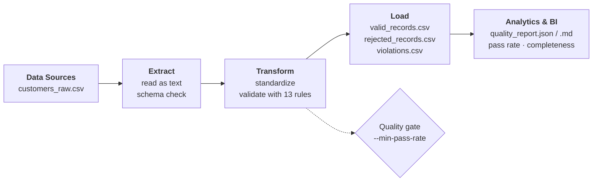

# 03 · Data Quality & Validation

Detect duplicates, missing values, wrong types, inconsistent dates and invalid records;
quarantine what fails and **explain exactly why**.

**Demonstrates:** validation · business rules · data quality metrics · traceability.

---

## 1. Problem

Bad data silently breaks reports, models and decisions. Typical examples: the same customer
loaded twice, an e-mail without a domain, an age of `150`, a signup date in the year 2099.
Cleaning these by hand is not repeatable, and dropping bad rows without a trace makes it
impossible to fix the problem at its source.

## 2. Analysis

Input: `data/raw/customers_raw.csv` — 21 customer records, `customer_id, full_name, email, signup_date, age, country, lifetime_value`.

Problems injected on purpose (one or more per record):

| Category | Examples in the sample |
|----------|------------------------|
| Duplicates | repeated `customer_id` (C005); same e-mail used by two customers (C002 / C014) |
| Missing values | empty e-mail (C006), empty name (C016) |
| Wrong types | age `abc` (C009), lifetime value `N/A` (C018) |
| Invalid format | e-mail without TLD (C004) |
| Inconsistent dates | month 13 (C007), signup date in 2099 (C008) |
| Out of range / invalid domain | age 150 (C010), country `XX` (C011), negative lifetime value (C012) |
| Harmless inconsistencies | country written as ` us ` (C017) → standardized, not rejected |

## 3. Proposed Solution

A rule-based validation engine:

1. **Schema check** — fail fast if required columns are missing.
2. **Standardize** safe issues (trim whitespace, lower-case e-mails, upper-case country codes).
3. **Evaluate a catalog of rules**, each with a stable ID, severity and description.
4. **Split** records: `error` → quarantined, `warning` → accepted but flagged.
5. **Report**: counts per rule, completeness per column, pass rate and the SHA-256 of the input file.
6. Optional **quality gate**: exit code `2` if the pass rate is below a threshold (useful in orchestrators / CI).

Rules are *declarative* (`src/rules.py`): adding a rule means adding one entry, not changing the engine.

## 4. Architecture



## 5. Implementation

| File | Responsibility |
|------|----------------|
| `src/rules.py` | Catalog of 13 rules (`Rule` dataclass: ID, name, severity, field, description, check). |
| `src/validator.py` | Schema check, standardization, rule evaluation, split into valid / rejected / violations. |
| `src/report.py` | JSON + Markdown report, input checksum. |
| `src/quality_pipeline.py` | CLI and quality gate. |
| `tests/test_quality_pipeline.py` | One test per rule, edge cases, traceability, quality gate, end-to-end vs. expected files. |

**Stack:** Python 3.10+, pandas.

## 6. Data Quality

| ID | Rule | Severity | Field |
|----|------|----------|-------|
| R001 | `duplicate_customer_id` (first occurrence kept) | error | customer_id |
| R002 | `missing_customer_id` | error | customer_id |
| R003 | `missing_full_name` | error | full_name |
| R004 | `missing_email` | error | email |
| R005 | `invalid_email_format` | error | email |
| R006 | `invalid_signup_date` (must be a real `YYYY-MM-DD` date) | error | signup_date |
| R007 | `future_signup_date` (later than `--as-of`) | error | signup_date |
| R008 | `age_not_numeric` | error | age |
| R009 | `age_out_of_range` (0–120) | error | age |
| R010 | `invalid_country_code` | error | country |
| R011 | `lifetime_value_not_numeric` | error | lifetime_value |
| R012 | `negative_lifetime_value` | error | lifetime_value |
| R013 | `duplicate_email` | **warning** | email |

**Traceability.** `violations.csv` has one row per (record, rule) failure with the **source row number**,
`customer_id`, rule ID, field and the **original value** that failed. Rules are evaluated independently,
so one record can fail several rules (`failed_rules = "R004,R008"`). Every input row ends up in exactly
one of `valid_records.csv` or `rejected_records.csv`, and the report stores the SHA-256 of the input
so a report can always be tied to the exact file it describes.

## 7. Results

| Metric | Value |
|--------|-------|
| Total rows | 21 |
| Valid rows | 10 (1 with a warning) |
| Rejected rows | 11 |
| Pass rate | 47.6 % |
| Completeness | `full_name` 95.2 % · `email` 95.2 % · everything else 100 % |

Excerpt of `violations.csv`:

| source_row | customer_id | rule_id | field | value |
|-----------:|-------------|---------|-------|-------|
| 5 | C004 | R005 | email | david.brown@example |
| 9 | C007 | R006 | signup_date | 2023-13-05 |
| 12 | C010 | R009 | age | 150 |
| 16 | C014 | R013 | email | bob.smith@example.com |

Full expected outputs: [`data/expected/`](data/expected/)
(`valid_records.csv`, `rejected_records.csv`, `violations.csv`, `quality_report.json`, `quality_report.md`).

## 8. Reproducibility

```bash
# from the repository root
python -m venv .venv && source .venv/bin/activate      # Windows: .venv\Scripts\activate
pip install -r 03-data-quality-pipeline/requirements.txt

python 03-data-quality-pipeline/src/quality_pipeline.py --as-of 2024-06-30
```

`--as-of` fixes the validation date so results never depend on the day you run the pipeline
(default: today). Quality gate example:

```bash
python 03-data-quality-pipeline/src/quality_pipeline.py --min-pass-rate 0.9   # exit code 2 on the sample data
pytest 03-data-quality-pipeline/tests -q
```

To validate your own file, keep the same column names and pass `--input path/to/file.csv`.
