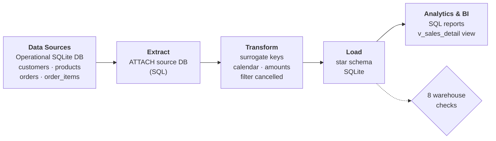
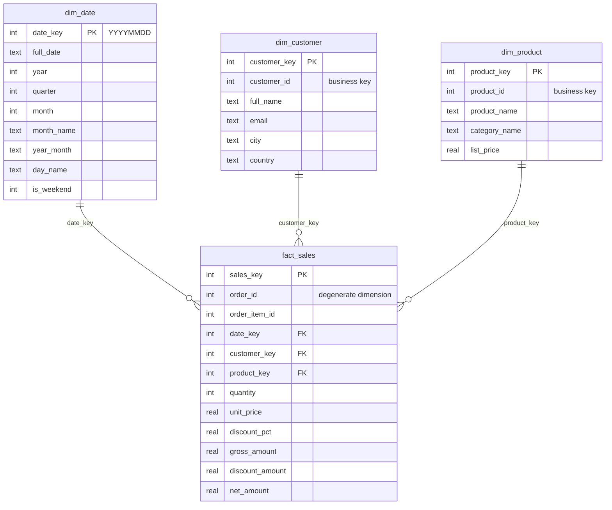

# 04 · Analytical Data Warehouse

Transform operational (OLTP) data into a **dimensional model** — a star schema with fact and
dimension tables — ready for SQL analysis and BI tools.

**Demonstrates:** data modeling · dimensional design · SQL · warehouse validation · BI readiness.

---

## 1. Problem

The operational database is normalized for *writing* orders quickly: answering a business question
such as *"net revenue by country and category per month"* needs five joins, date arithmetic and
careful handling of cancelled orders and discounts. Analysts repeat that logic (and get it wrong)
in every report.

## 2. Analysis

Source: a normalized operational database with `customers`, `categories`, `products`, `orders` and
`order_items` (8 customers, 6 products, 20 orders, 38 order lines).

Questions the model must answer easily: revenue over time, best-selling products, revenue by
country and category, and customer value.

Points that require decisions:

- **Grain:** one fact row per *order line* (finest level, so any aggregation is possible).
- **Cancelled orders** (3 of 20) must not count as revenue.
- **Historical prices:** the price actually charged (`unit_price`) can differ from the current `list_price`, so it is stored in the fact.
- **Dates:** analysts need year, quarter, month, weekday and weekend flags without date functions.

## 3. Proposed Solution

A **star schema** loaded by a full refresh:

- `fact_sales` — measures: quantity, unit price, discount %, gross, discount and **net amount** (computed once, at load time).
- `dim_date` — generated calendar, one row per day without gaps.
- `dim_customer`, `dim_product` — descriptive attributes, with **surrogate keys** independent from the source system's IDs.
- Eight automated **warehouse checks** (reconciliation with the source, orphan keys, grain, etc.) that stop the pipeline if anything is wrong.
- Analytical queries exported as CSV reports, and a `v_sales_detail` view for BI tools.

## 4. Architecture



Star schema:



## 5. Implementation

| File | Responsibility |
|------|----------------|
| `sql/operational_schema.sql`, `sql/operational_seed.sql` | Source system (3NF) and deterministic sample data. |
| `sql/warehouse_schema.sql` | DDL of the star schema, indexes and `v_sales_detail`. |
| `sql/load_warehouse.sql` | `INSERT … SELECT` statements that populate dimensions (including a recursive-CTE calendar) and facts. |
| `sql/analytics_queries.sql` | Named analytical queries (`-- name: …`). |
| `src/build_operational.py` | Creates the source database. |
| `src/build_warehouse.py` | Builds the warehouse and runs the validation checks. |
| `src/warehouse_pipeline.py` | CLI: build → load → validate → export reports. |
| `tests/test_warehouse_pipeline.py` | Grain, reconciliation, date attributes, failure detection, idempotency, reports vs. expected. |

**Stack:** Python 3.10+, SQLite (SQL does the heavy lifting), pandas for report export.

Modeling notes: dimensions use Type 1 (overwrite) changes. Moving `dim_customer` to Type 2
(history with `valid_from` / `valid_to`) is the natural next step.

## 6. Data Quality

The pipeline stops with exit code `1` if any check fails:

| Check | Purpose |
|-------|---------|
| Fact rows = completed order lines in the source | No rows lost or duplicated |
| Net revenue reconciles with the source system | Numbers match the operational truth |
| No orphan date / customer / product keys | Referential integrity |
| `gross = net + discount` on every row | Measure consistency |
| No cancelled orders in the fact table | Business rule |
| Calendar has no gaps | Complete date dimension |

Foreign keys are also declared in the DDL, and the tests additionally run `PRAGMA foreign_key_check`.

## 7. Results

| Table | Rows |
|-------|-----:|
| `dim_date` | 84 |
| `dim_customer` | 8 |
| `dim_product` | 6 |
| `fact_sales` | 32 (of 38 order lines; 6 belong to cancelled orders) |

`monthly_revenue` report:

| year_month | orders | units | gross_revenue | discounts | net_revenue |
|------------|-------:|------:|--------------:|----------:|------------:|
| 2024-01 | 7 | 33 | 2,229.07 | 129.27 | 2,099.80 |
| 2024-02 | 5 | 16 | 889.87 | 23.60 | 866.27 |
| 2024-03 | 5 | 31 | 2,724.33 | 80.65 | 2,643.68 |

`top_products` report (net revenue): 27-Inch Monitor 2,656.40 · Mechanical Keyboard 1,257.58 ·
Webcam HD 566.40 · USB-C Hub 469.20 · Wireless Mouse 441.77.

Example of what the model makes easy:

```sql
SELECT year_month, category_name, ROUND(SUM(net_amount), 2) AS net_revenue
FROM v_sales_detail
GROUP BY year_month, category_name
ORDER BY year_month, net_revenue DESC;
```

All reports are versioned in [`data/expected/reports/`](data/expected/reports/).

## 8. Reproducibility

```bash
# from the repository root
python -m venv .venv && source .venv/bin/activate      # Windows: .venv\Scripts\activate
pip install -r 04-analytical-data-warehouse/requirements.txt

python 04-analytical-data-warehouse/src/warehouse_pipeline.py
```

Generated in `data/output/`: `operational.db`, `warehouse.db`, `reports/*.csv`, `run_summary.json`.

```bash
sqlite3 04-analytical-data-warehouse/data/output/warehouse.db "SELECT * FROM v_sales_detail LIMIT 5;"
pytest 04-analytical-data-warehouse/tests -q
```

Connect any BI tool that supports SQLite (DBeaver, Metabase, Power BI via ODBC, …) to
`data/output/warehouse.db` and use the `fact_*` / `dim_*` tables or the `v_sales_detail` view.
