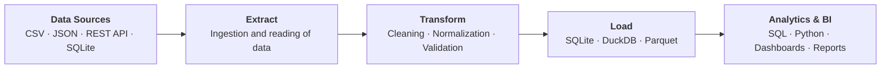

# Data Pipelines Portfolio

A collection of small, **fully reproducible data engineering projects**. Each one solves a
realistic problem end to end — from raw data to analysis-ready tables — and ships with sample
input data, the expected output, automated tests and complete documentation, so anyone can clone
the repository, run a pipeline and verify the result.

## Projects

| # | Project | What it solves | Demonstrates |
|---|---------|----------------|--------------|
| 01 | [Sales Data Integration](01-sales-data-pipeline/) | Merge several CSV files with different structures, normalize columns, resolve inconsistencies and load them into SQLite (or DuckDB). | Python · Pandas · SQL · ETL |
| 02 | [API Data Extraction](02-api-data-integration/) | Consume a public REST API: pagination, retries, nested JSON, storage and an ingestion log. | APIs · requests · JSON · pagination · automation |
| 03 | [Data Quality & Validation](03-data-quality-pipeline/) | Detect duplicates, missing values, wrong types, inconsistent dates and invalid records, with full traceability. | Validation · business rules · data quality · traceability |
| 04 | [Analytical Data Warehouse](04-analytical-data-warehouse/) | Turn operational data into a star schema with fact and dimension tables. | Data modeling · SQL · analytical design · BI |

## Common pipeline flow

Every project follows the same ETL structure:



## Repository structure

```
data-pipelines/
├── README.md
├── LICENSE
├── Makefile                          # shortcuts: make install / run-all / test
├── pytest.ini
├── requirements.txt                  # all runtime dependencies
├── requirements-dev.txt              # + pytest
├── .github/workflows/ci.yml          # runs tests and every pipeline on each push
│
├── docs/
│   └── PROJECT_README_TEMPLATE.md    # template for documenting new projects
│
├── shared/                           # code reused by all pipelines (logging, SQLite helpers)
│
├── 01-sales-data-pipeline/
│   ├── README.md
│   ├── data/{raw,reference,expected,output}/
│   ├── src/{extract.py,transform.py,load.py,pipeline.py}
│   ├── tests/
│   └── requirements.txt
│
├── 02-api-data-integration/
│   ├── README.md
│   ├── data/{sample,expected,output}/
│   ├── src/{api_client.py,normalize_json.py,storage.py,api_pipeline.py}
│   ├── tests/
│   └── requirements.txt
│
├── 03-data-quality-pipeline/
│   ├── README.md
│   ├── data/{raw,expected,output}/
│   ├── src/{rules.py,validator.py,report.py,quality_pipeline.py}
│   ├── tests/
│   └── requirements.txt
│
└── 04-analytical-data-warehouse/
    ├── README.md
    ├── data/{expected,output}/
    ├── sql/                          # schemas, load logic and analytical queries
    ├── src/
    ├── tests/
    └── requirements.txt
```

Each project folder uses the same convention:

| Folder | Content |
|--------|---------|
| `data/raw` or `data/sample` | Example **input** data (includes deliberate problems to solve) |
| `data/expected` | The **expected results**, used by the tests to verify the pipeline |
| `data/output` | Where a run writes its results (git-ignored) |

## Quick start

Requirements: **Python 3.10+** (developed and tested with Python 3.12 and pandas 3.0).

```bash
git clone https://github.com/<your-user>/data-pipelines.git
cd data-pipelines

python -m venv .venv
source .venv/bin/activate            # Windows: .venv\Scripts\activate
pip install -r requirements-dev.txt

make run-all                         # runs the four pipelines
make test                            # runs the 60 automated tests
```

Without `make`, run each pipeline directly:

```bash
python 01-sales-data-pipeline/src/pipeline.py
python 02-api-data-integration/src/api_pipeline.py
python 03-data-quality-pipeline/src/quality_pipeline.py --as-of 2024-06-30
python 04-analytical-data-warehouse/src/warehouse_pipeline.py
pytest
```

All pipelines can be launched from any working directory.

## How each project is documented

Every project README follows the same structure:

| Section | Answers |
|---------|---------|
| **Problem** | What problem exists? |
| **Analysis** | Which data is needed and what makes it difficult? |
| **Proposed Solution** | Which pipeline was designed, and why? |
| **Architecture** | ETL flow diagram |
| **Implementation** | Code structure and technologies |
| **Data Quality** | Validations and controls |
| **Results** | Data processed, transformations and outcomes |
| **Reproducibility** | How to run the project from scratch |

A blank template is available in [`docs/PROJECT_README_TEMPLATE.md`](docs/PROJECT_README_TEMPLATE.md).

## Tech stack

Python · pandas · SQL · SQLite · `requests` · pytest · GitHub Actions
(optional: DuckDB, Parquet via PyArrow)

## Design principles

- **Reproducible:** sample input and expected output are versioned; tests compare both.
- **Traceable:** bad records are quarantined with a reason, never silently dropped.
- **Idempotent:** running a pipeline twice gives the same result.
- **Testable:** business rules are small functions with unit tests; no test needs internet access.

## License

MIT — see [LICENSE](LICENSE).
