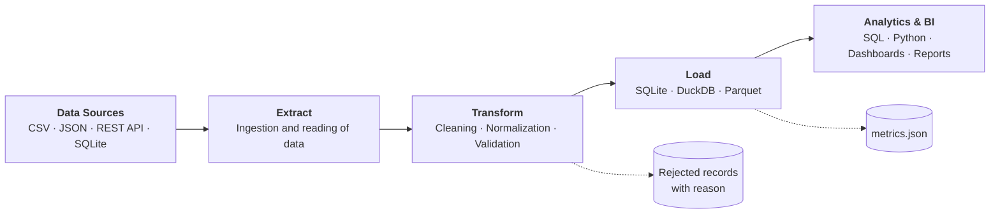

# Data Pipelines Portfolio

Data pipelines are more than scripts that move data from one place to another. Reliable analysis depends on how data is extracted, validated, transformed, stored and made available for decision-making.

This repository explores practical data engineering scenarios through reproducible Python and SQL pipelines, focusing on **data integration, quality, traceability and analytical modeling**.

Each project starts from a concrete problem, ships with messy sample input and the exact expected output, and reports what it did with every record it received.

---

## Four problems, four pipelines

The projects follow the life of data: integrate it, acquire it, trust it, model it.

### 01 · Sales Data Integration
**The problem.** Three sales channels export three incompatible CSV files (different delimiters, date formats, decimal separators, product identifiers). Nobody can answer *"how much did we sell last month?"* until they are integrated — and an integration that silently discards rows cannot be trusted.
**The pipeline.** Normalizes every source into one schema, resolves products against a catalog, applies business rules, and loads clean data into SQLite while quarantining each rejected row with a reason code.
**Demonstrates:** Python · Pandas · SQL · ETL → [project](01-sales-data-pipeline/)

### 02 · API Data Extraction
**The problem.** Data behind an API is paginated, nested, occasionally incomplete and sometimes unavailable. A script that works today fails silently tomorrow, and nobody knows when data was last loaded or whether the run succeeded.
**The pipeline.** Retries transient failures with exponential backoff, walks pagination, flattens nested JSON, upserts into SQLite, keeps raw snapshots and writes an ingestion log for every run.
**Demonstrates:** REST APIs · JSON · pagination · error handling · automation → [project](02-api-data-integration/)

### 03 · Data Quality & Validation
**The problem.** Bad data rarely announces itself: a duplicated customer, an e-mail without a domain, a signup date in 2099. Fixing it by hand is not repeatable, and dropping it without a trace makes it impossible to correct the source.
**The pipeline.** Evaluates a catalog of 13 declarative rules, quarantines failures, accepts-but-flags warnings, and records for every violation the source row, the rule and the original value.
**Demonstrates:** validation · business rules · data quality · traceability → [project](03-data-quality-pipeline/)

### 04 · Analytical Data Warehouse
**The problem.** Operational databases are designed to record transactions, not to answer business questions. Getting *"net revenue by country and category per month"* out of them takes five joins and careful handling of cancelled orders and discounts — logic every analyst rewrites, and gets wrong, differently.
**The pipeline.** Builds a star schema (one fact table, three dimensions), computes the measures once, and stops if the warehouse does not reconcile with the source system.
**Demonstrates:** data modeling · SQL · dimensional design · BI readiness → [project](04-analytical-data-warehouse/)

---

## Results at a glance

What each pipeline does with the data it receives (bundled sample data):

| Pipeline | Received | Valid | Rejected | Duplicates detected | Validations passed | Execution time |
|----------|---------:|------:|---------:|--------------------:|-------------------:|---------------:|
| 01 · Sales Data Integration | 26 | 18 | 8 | 1 | 6 / 6 | 44 ms |
| 02 · API Data Extraction | 35 | 32 | 3 | 1 | 5 / 5 | 36 ms |
| 03 · Data Quality & Validation | 21 | 10 | 11 | 2 | 5 / 5 | 32 ms |
| 04 · Analytical Data Warehouse | 38 | 32 | 6 | 0 | 8 / 8 | 28 ms |

How to read it:

- **Received = valid + rejected** in every pipeline. No record disappears: each rejected one is stored with the reason it failed.
- **Rejected** is not always "bad data". In 04 it means the lines of cancelled orders, which are deliberately kept out of the fact table.
- **Validations** are the integrity checks each run performs on itself (for example: nothing lost, keys unique, database equals clean data, no orphan keys, totals reconcile with the source). A failed check stops the pipeline with a non-zero exit code.
- **Execution time** is the median of 7 runs on the machine that generated this repository. The sample datasets are tiny, so treat it as a regression baseline, not a performance claim; re-measure on your own machine with `make metrics`.

Every run writes a `metrics.json` with these figures and the name and result of each individual check. Definitions, per-check results and details for each pipeline are in [`docs/METRICS.md`](docs/METRICS.md).

---

## Common pipeline flow



## Quick start

Requirements: **Python 3.10+** (developed and tested with Python 3.12 and pandas 3.0).

```bash
git clone https://github.com/<your-user>/data-pipelines.git
cd data-pipelines

python -m venv .venv
source .venv/bin/activate            # Windows: .venv\Scripts\activate
pip install -r requirements-dev.txt

make run-all                         # run the four pipelines
make metrics                         # re-measure the table above (writes docs/METRICS.md)
make test                            # 67 automated tests
```

Without `make`:

```bash
python 01-sales-data-pipeline/src/pipeline.py
python 02-api-data-integration/src/api_pipeline.py
python 03-data-quality-pipeline/src/quality_pipeline.py --as-of 2024-06-30
python 04-analytical-data-warehouse/src/warehouse_pipeline.py
python scripts/collect_metrics.py
pytest
```

All pipelines can be launched from any working directory.

## Repository structure

```
data-pipelines/
├── README.md
├── LICENSE
├── Makefile                          # make install / run-all / metrics / test / clean
├── pytest.ini
├── requirements.txt
├── requirements-dev.txt
├── .github/workflows/ci.yml          # tests + every pipeline on each push
│
├── docs/
│   ├── METRICS.md                    # generated: metrics per pipeline
│   └── PROJECT_README_TEMPLATE.md    # template to document new projects
│
├── scripts/
│   └── collect_metrics.py            # runs every pipeline and builds the metrics table
│
├── shared/                           # logging, SQLite helpers, standard run metrics
├── tests/                            # tests of the shared code
│
├── 01-sales-data-pipeline/           # README · data/{raw,reference,expected,output} · src · tests
├── 02-api-data-integration/          # README · data/{sample,expected,output} · src · tests
├── 03-data-quality-pipeline/         # README · data/{raw,expected,output} · src · tests
└── 04-analytical-data-warehouse/     # README · data/{expected,output} · sql · src · tests
```

Each project follows the same convention:

| Folder | Content |
|--------|---------|
| `data/raw` or `data/sample` | Example **input** data, with deliberate problems to solve |
| `data/expected` | The **expected results**; the tests compare every run against them |
| `data/output` | Where a run writes its results, including `metrics.json` (git-ignored) |

## How each project is documented

| Section | Answers |
|---------|---------|
| **Problem** | What problem exists? |
| **Analysis** | Which data is needed and what makes it difficult? |
| **Proposed Solution** | Which pipeline was designed, and why? |
| **Architecture** | ETL flow diagram |
| **Implementation** | Code structure and technologies |
| **Data Quality** | Validations and controls |
| **Results** | Data processed, transformations and run metrics |
| **Reproducibility** | How to run the project from scratch |

A blank template is in [`docs/PROJECT_README_TEMPLATE.md`](docs/PROJECT_README_TEMPLATE.md).

## Design principles

- **Traceable:** bad records are quarantined with a reason, never silently dropped.
- **Reproducible:** sample input and expected output are versioned; tests compare both.
- **Self-verifying:** every run reconciles its output with its input and reports the result.
- **Idempotent:** running a pipeline twice gives the same result.
- **Offline-testable:** no test needs internet access.

## Tech stack

Python · pandas · SQL · SQLite · `requests` · pytest · GitHub Actions
(optional: DuckDB, Parquet via PyArrow)

## License

MIT — see [LICENSE](LICENSE).
