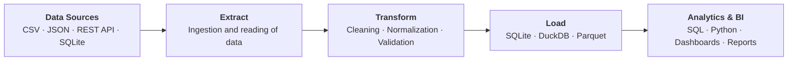

# NN · Project Title

One-sentence summary of what the pipeline does.

**Demonstrates:** skill 1 · skill 2 · skill 3.

---

## 1. Problem

What problem exists? Who suffers from it and what does it cost (time, errors, wrong decisions)?

## 2. Analysis

Which data is needed? Describe each source (format, volume, structure) and the difficulties it presents
(inconsistent formats, duplicates, missing values, API limits, ...).

## 3. Proposed Solution

Which pipeline did you design? List the main stages and the key design decisions (and why).

## 4. Architecture



## 5. Implementation

| File | Responsibility |
|------|----------------|
| `src/...` | ... |

**Stack:** ...

## 6. Data Quality

Validations and controls: which rules exist, what happens to records that fail, how row counts are reconciled.

## 7. Results

Data processed, transformations applied and the outcome (counts, tables, example queries).
Point to the versioned expected output in `data/expected/`.

## 8. Reproducibility

```bash
pip install -r requirements.txt
python src/<entry_point>.py
pytest tests -q
```
